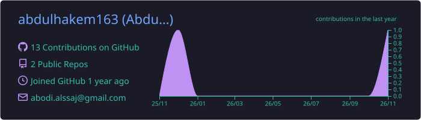
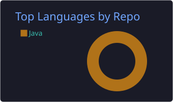
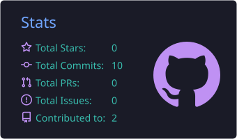
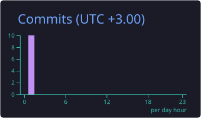

# Hi there, I'm Abdul Hakem 👋

### Frontend Developer | React.js Developer

Building modern, responsive, and user-friendly web applications.

---

## 👨‍💻 About Me

- 🎓 Software Engineering Student.
- 💻 Frontend Developer passionate about building web applications.
- ⚛️ Experienced in React.js and modern frontend development.
- 🎨 Interested in creating clean and responsive user interfaces.
- 🔌 Experienced in integrating REST APIs.
- 🌱 Always learning and improving my development skills.

---

## 🛠️ Tech Stack

<h3 align="center">💻 Frontend Development</h3>

  

<h3 align="center">🗄️ Backend & Database</h3>

  

<h3 align="center">⚙️ Tools & Technologies</h3>

  

  
  
  

---

## 🚀 Featured Projects

### 🏗️ Renova Platform — Construction & Renovation System

A team-based, multi-role platform connecting Customers, Contractors, Engineers, and Administrators to manage construction and renovation projects.

**My Contribution:** Frontend Development — React Admin Dashboard.

**Key Features:**
- Multi-role management and access control.
- Contractor and engineer registration approval.
- Site visit assignment and management.
- Construction forms and payment management.
- Complaints and project monitoring.
- Platform analytics dashboard.

**Technologies:**
React.js • Laravel 11 • Flutter • MySQL • Redis • Firebase

🔗 **[View Repository](https://github.com/karamlk/renova)**

---

## 📊 GitHub Stats

---

### 💙 Code • Create • Innovate

