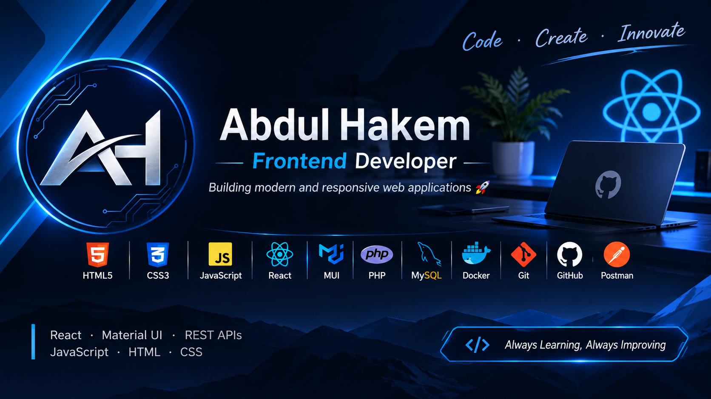

 

# Hi there, I'm Abdul Hakem 👋

### Frontend Developer | React.js Developer

Building modern, responsive, and user-friendly web applications.

---

## 👨‍💻 About Me

- 🎓 Software Engineering Student.
- 💻 Frontend Developer passionate about building web applications.
- ⚛️ Experienced in React.js and modern frontend development.
- 🎨 Interested in creating clean and responsive user interfaces.
- 🔌 Experienced in integrating REST APIs.
- 🌱 Always learning and improving my development skills.

---

## 🛠️ Tech Stack

<h3 align="center">💻 Frontend Development</h3>

  

<h3 align="center">🗄️ Additional Technologies</h3>

  

<h3 align="center">⚙️ Tools & Technologies</h3>

  

  
  
  

---

## 🚀 Featured Projects

### 🏗️ Renova Platform — Construction & Renovation Management System

Renova is a collaborative, multi-role platform designed to streamline construction and renovation workflows by connecting customers, contractors, engineers, and administrators.

The platform provides tools for managing renovation requests, coordinating site inspections, monitoring construction progress, handling payments, and overseeing project operations.

**My Contribution — React Admin Dashboard**

I contributed to the frontend development of the administrative dashboard using React.js, focusing on building user interfaces for platform management and administrative workflows.

**Key Platform Features:**
- Multi-role management and access control.
- Customer requests and contractor management.
- Engineer registration and approval workflows.
- Site inspection scheduling and management.
- Construction forms and payment tracking.
- Complaint management and project monitoring.
- Administrative analytics and dashboards.

**Technologies:**

React.js • Laravel 11 • Flutter • MySQL • Redis • Firebase

🔗 **[View Project Repository](https://github.com/karamlk/renova)**

---

## 🔥 GitHub Streak

  

---

## 📫 Contact Me

  

  

  

### 💙 Code • Create • Innovate

